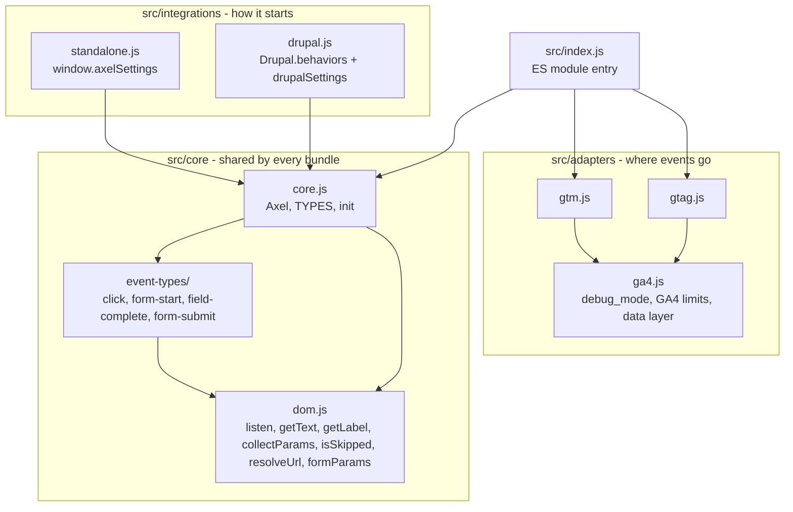
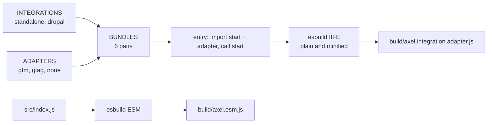
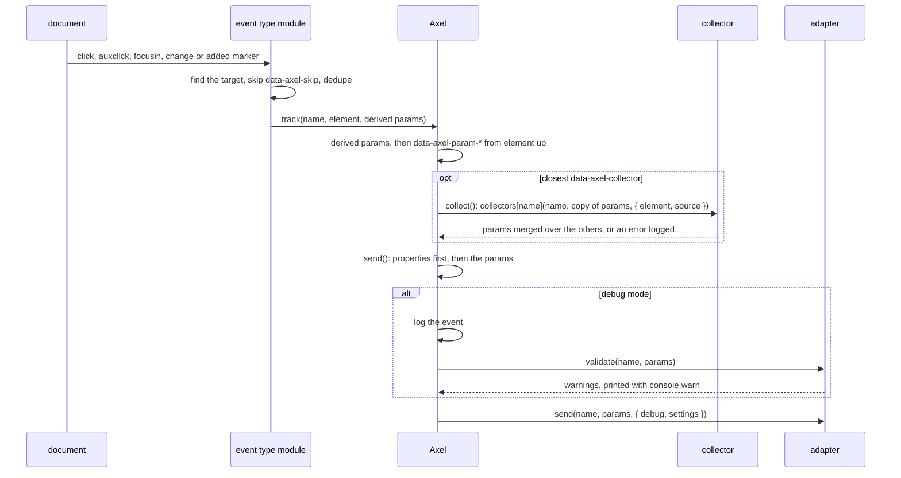

# Architecture

This page walks through how the library works: how the source splits into layers, how the bundles are built from them and how an interaction becomes an event in an adapter. Each section is derived from the source files it names, and diagrams sit next to the prose that discusses them.

This document is generated and maintained by an AI agent via the `update-architecture-docs` skill in `.claude/skills/update-architecture-docs/SKILL.md`. The content is derived from the source code. If this documentation and the code disagree, the code wins.

## Layers

The source splits into 3 layers, and no layer imports another layer's siblings:

- `src/core/` turns interactions into events. It holds no Google or Drupal code. `core.js` holds the `Axel` class and the `TYPES` registry, which maps each event type name to its module in `event-types/`.
- `src/adapters/` delivers events. An adapter is an object with `send(name, params, context)` and an optional `validate(name, params)`, or a function used as `send()`. `gtm.js` and `gtag.js` share `ga4.js`, which adds `debug_mode` in debug mode, checks the GA4 limits and finds the data layer by `dataLayerName`.
- `src/integrations/` starts the core. Each exports `start(adapter)`, which falls back to `window.axelAdapter` when no adapter is passed.

The constructor in `core.js` merges the settings over `DEFAULT_SETTINGS`, wraps a function adapter as `{ send }` and throws on a missing adapter, a type name missing from `TYPES` or a `collectors` entry that isn't a function.

## Bundles

`scripts/bundles.js` pairs every integration with every adapter. A standalone bundle adds no integration segment to its name, and a bundle without an adapter adds no adapter segment, so the 6 bundles are `axel.gtm`, `axel.gtag`, `axel`, `axel.drupal.gtm`, `axel.drupal.gtag` and `axel.drupal`. `entry()` generates each bundle's source: it imports the integration's `start()` and the adapter, then calls `start(adapter)`.

`scripts/build.js` passes each generated entry to esbuild through `stdin` and writes a plain and a minified IIFE to `build/`. esbuild drops the modules a bundle doesn't import, so each bundle holds only its own integration and adapter. `src/index.js` builds separately into `build/axel.esm.js`, which `package.json` points `main`, `module` and `exports` at.

## Starting

The standalone `start()` reads `window.axelSettings`, exposes the class as `window.Axel` and initializes the shared instance straight away, unless `autoInit` is false. Delegated listeners don't need the DOM to be ready, so the script can load in `<head>`.

The Drupal `start()` exposes the class and registers `Drupal.behaviors.axel`. Its `attach()` calls `init()` with `drupalSettings.axel` and the adapter. `init()` creates the shared instance on the first call and returns it on later calls, so AJAX attaches change nothing.

Both integrations override any `adapter` key in the settings with their own adapter. Both also merge `window.axelCollectors` under the `collectors` setting, because `drupalSettings` is JSON and can't carry functions.

## Lifecycle

`init()` on an instance calls each configured event type module once and stores the cleanup functions it returns. While they are stored, `init()` does nothing, so an instance never binds twice. `destroy()` runs the cleanups, clears them and releases the shared instance when it is the one destroyed, so `init()` can start again.

The `click`, `form_start` and `field_complete` modules add capture-phase listeners on `document` through `listen()`. Capture runs before page handlers can stop propagation, and delegation covers markup added after load. `form_submit` scans the document for `data-axel-form-submitted` markers and watches it with a `MutationObserver` for markers added later.

## From interaction to adapter

Each event type decides whether an interaction counts and derives its own parameters:

- `click` takes the closest `clickSelector` match of the target, needs an ancestor with `data-axel-event` for the name and derives `link_text`, `click_type` and `link_url`. `getSubmitDestination()` gives a submit button its `formaction` or its form's `action` as `link_url`. Inside the closest `data-axel-group` or `data-axel-subgroup`, `getGroupTitle()` adds `group_title` or `subgroup_title`. It searches the group, or the ancestor its `-scope` selector matches, with `findTitle()`: the last match that precedes the element in document order, isn't its ancestor and isn't skipped. A `data-axel-group-title` marker is tried before `groupTitleSelector`. It handles `auxclick` only for the middle button.
- `form_start` takes the closest `data-axel-form` and records it in a `WeakSet`, so each form element starts once.
- `field_complete` sends on every `change` inside a marked form, with the form parameters, `field_name` and a `field_label` that never reads a value. A radio never reports its own label.
- `form_submit` records each marker in a `WeakSet` and sends its `form_name`. `formSubmitted()` sends the same event directly, whatever the configured types.

`track()` lets `data-axel-param-*` values override derived parameters, then merges what `collect()` returns over both. `collect()` looks the closest `data-axel-collector` name up with `Object.hasOwn()`, so a name such as `toString` can't reach the prototype. An unknown name, a throw or a non-object result logs `console.error` and adds nothing, so the event still goes out. `send()` puts the `properties` setting underneath everything. `isDebug()` reads the debug hash and `sessionStorage` on every send, so debug mode survives navigation within a tab and falls back to the hash when storage is blocked.

The `gtm` adapter pushes `{ ...params, event }` to the data layer, so a parameter named `event` can't replace the event name. The `gtag` adapter calls `window.gtag('event', name, params)` when the Google tag is present, and otherwise pushes an `arguments` object to the data layer, the shape the Google tag reads when it loads.

## Regenerating this document

To update this documentation after a structural change, ask the AI agent to "update architecture docs". The agent re-traces the affected diagrams and prose from the current code via the `update-architecture-docs` skill.
