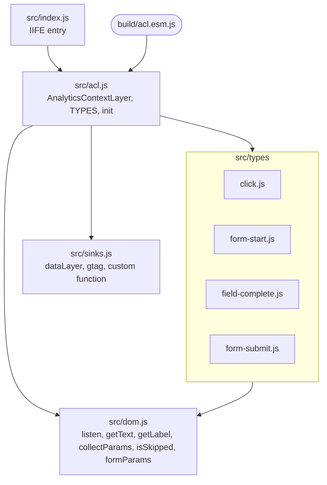
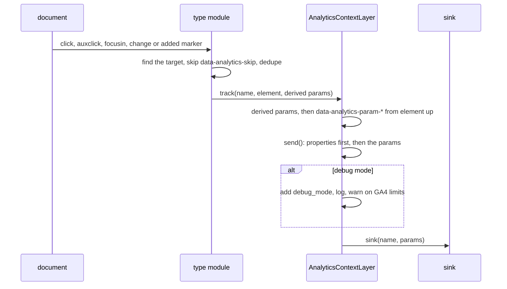

# Architecture

This page walks through how the library works: what ships in the bundles, how the pieces fit together and how an interaction becomes an event in a sink. Each section is derived from the source files it names, and diagrams sit next to the prose that discusses them.

This document is generated and maintained by an AI agent via the `update-architecture-docs` skill in `.claude/skills/update-architecture-docs/SKILL.md`. The content is derived from the source code. If this documentation and the code disagree, the code wins.

## Components

`src/acl.js` holds the `AnalyticsContextLayer` class and the `TYPES` registry, which maps each event type name to its module. The constructor merges the settings over `DEFAULT_SETTINGS`, resolves the sink with `createSink()` and throws on a type name missing from `TYPES`. Each type module takes the instance and returns a cleanup function. `src/dom.js` holds the helpers the types share, so no type reads the DOM differently from another.

## Bundles

esbuild builds 3 files. `build/acl.js` and the minified `build/acl.min.js` are IIFE bundles of `src/index.js`. `build/acl.esm.js` is an ESM bundle of `src/acl.js`, and `package.json` points `main`, `module` and `exports` at it.

`src/index.js` exposes the class as `window.AnalyticsContextLayer`. Unless `window.analyticsContextLayerSettings.autoInit` is false, it calls the module `init()` with those settings straight away and exposes the shared instance as `window.analyticsContextLayer`. With `autoInit` false, it exposes an uninitialized instance for the site to start later. The module `init()` creates the shared instance on its first call and returns it on later calls, ignoring their settings.

## Lifecycle

`init()` calls each configured type module once and stores the cleanup functions it returns. While they are stored, `init()` does nothing, so an instance never binds twice. `destroy()` runs the cleanups, clears them and releases the shared instance when it is the one destroyed, so `init()` can start again.

The `click`, `form_start` and `field_complete` modules add capture-phase listeners on `document` through `listen()`. Capture runs before page handlers can stop propagation, and delegation covers markup added after load. `form_submit` scans the document for `data-analytics-form-submitted` markers and watches it with a `MutationObserver` for markers added later.

## From interaction to sink

Each type decides whether an interaction counts and derives its own parameters:

- `click` takes the closest `clickSelector` match of the target, needs an ancestor with `data-analytics-event` for the name and derives `link_text` and `link_url`. It handles `auxclick` only for the middle button.
- `form_start` takes the closest `data-analytics-form` and records it in a `WeakSet`, so each form element starts once.
- `field_complete` sends on every `change` inside a marked form, with the form parameters, `field_name` and a `field_label` that never reads a value.
- `form_submit` records each marker in a `WeakSet` and sends its `form_name`. `formSubmitted()` sends the same event directly, whatever the configured types.

`track()` lets `data-analytics-param-*` values override derived parameters, and `send()` puts the `properties` setting underneath both. `isDebug()` reads the debug hash and `sessionStorage` on every send, so debug mode survives navigation within a browser session and falls back to the hash when storage is blocked.

## Sinks

`createSink()` returns a custom function as it is. `'dataLayer'` pushes `{ event, ...params }` to `window[dataLayerName]`. `'gtag'` calls `window.gtag('event', name, params)` when the Google tag is present, and otherwise pushes an `arguments` object to the data layer, the shape the Google tag reads when it loads. Any other value throws.

## Regenerating this document

To update this documentation after a structural change, ask the AI agent to "update architecture docs". The agent re-traces the affected diagrams and prose from the current code via the `update-architecture-docs` skill.
