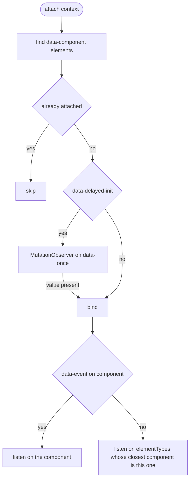
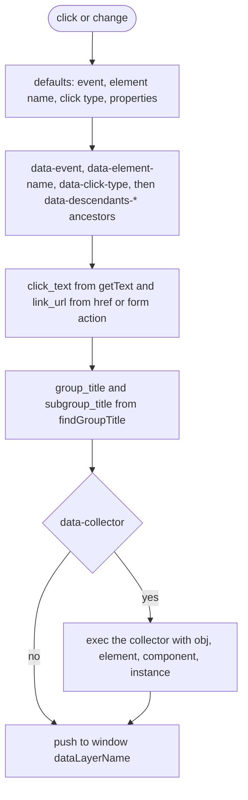

# Architecture

This page walks through how the library works: what ships in the bundle and how an interaction becomes a data layer push. Each section is derived from the source files it names, and diagrams sit next to the prose that discusses them.

This document is generated and maintained by an AI agent via the `update-architecture-docs` skill in `.claude/skills/update-architecture-docs/SKILL.md`. The content is derived from the source code. If this documentation and the code disagree, the code wins.

## Bundle

esbuild bundles `src/index.js` and `src/acl.js` into 2 IIFE files: `build/acl.js` and the minified `build/acl.min.js`. `src/index.js` creates 1 `AnalyticsContextLayer` instance from `window.analyticsContextLayerSettings` and exposes it as `window.analyticsContextLayer`, with the class as `window.AnalyticsContextLayer`. When `autoAttach` is true, the instance attaches to the document after `DOMContentLoaded`, or straight away if the DOM is already loaded.

## Binding

`attach()` records each component in a `WeakSet`, so repeated calls bind each component once. `bind()` listens for `change` on selects and `click` on every other element. Elements inside a nested component belong to that nested component only.

## Collecting and pushing

`collect()` builds the object and `push()` appends it to the data layer, logging it first in debug mode. A collector that fails to resolve or throws logs an error, and the object is still pushed.

## Regenerating this document

To update this documentation after a structural change, ask the AI agent to "update architecture docs". The agent re-traces the affected diagrams and prose from the current code via the `update-architecture-docs` skill.
